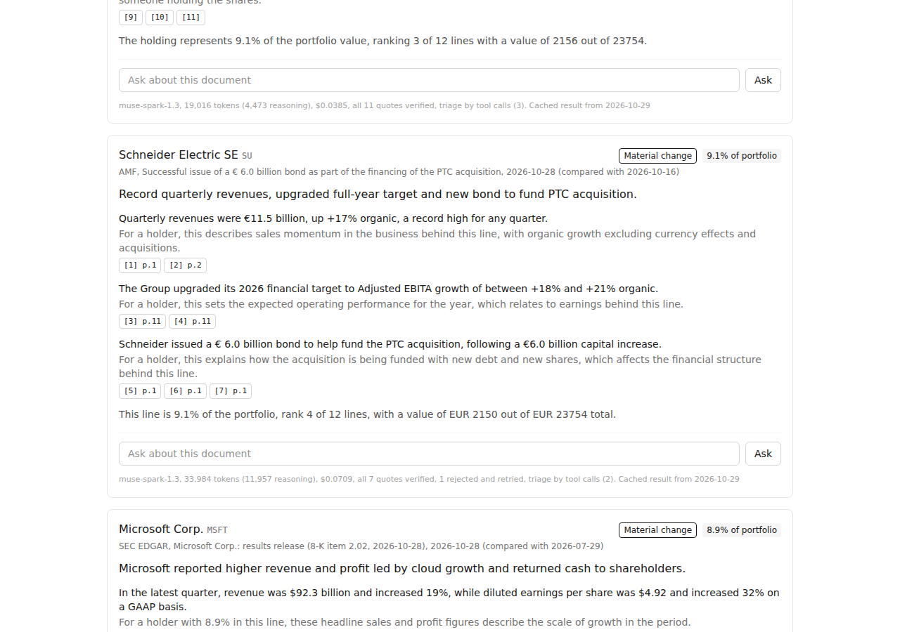
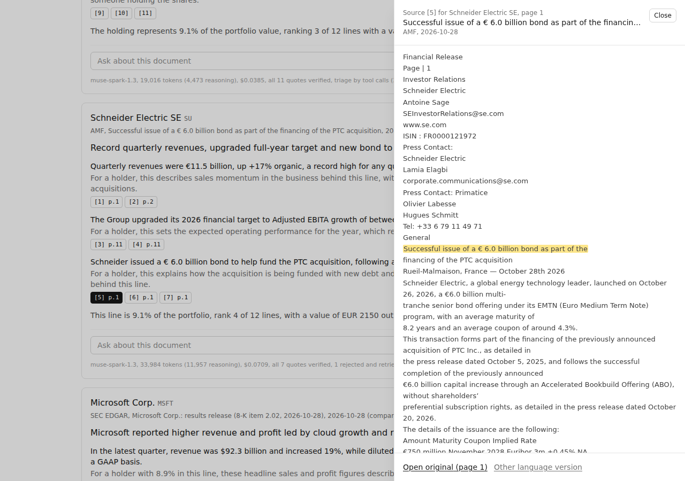
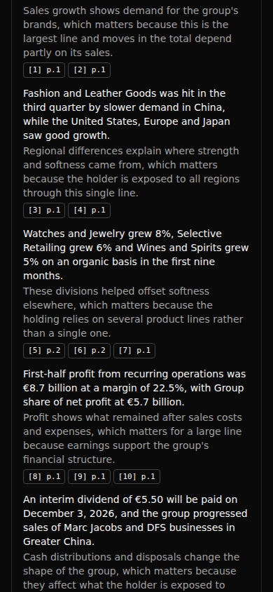
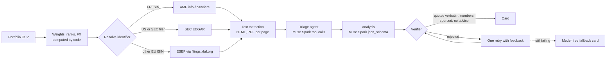

# Fynex Copilot

**What changed in your stocks, with the source.**

An AI investment copilot for retail investors, built at the [Meta Global AI Developer Hackathon](https://cerebralvalley.ai/e/meta-ai-developer-hackathon/details) (Startups track) on **Muse Spark** through the **Meta Model API**.

Drop your portfolio as a CSV. For every holding, Fynex Copilot fetches the latest official documents (earnings releases and filings from SEC EDGAR, regulated information from the French AMF, ESEF annual reports for other European issuers), has Muse Spark read them, and tells you in plain language:

- **what changed** (results, guidance, capital, strategy, risk),
- **why it matters for your portfolio**, given the weight of that line,
- **where it says so**: every claim links to the exact passage, highlighted in the original document.

It never tells you to buy or sell. It explains documents.

See a real output: [`examples/sample-run.md`](examples/sample-run.md) (12 holdings, 52 claims, 116 quotes, every one verified word for word by the server, $0.67 of Muse Spark).

| Portfolio and "What changed" feed | Source panel on the highlighted passage | Phone, dark mode |
|---|---|---|
|  |  |  |

## Run the demo

Requires Node.js 20.9 or later.

```bash
git clone https://github.com/LouisLanganay/fynex-copilot.git
cd fynex-copilot
npm install
npm run demo        # http://localhost:3000, no key needed
```

Click **Try the sample portfolio**, then **Analyze 12 holdings**. Without a key the app replays the recorded live run of [`samples/portfolio.csv`](samples/portfolio.csv) (instant, no model call), labelled "Cached result from 2026-10-29". Click any `[n]` chip to open the source panel on the highlighted passage, and type "Should I sell?" in a card to see the refusal.

Live run, with a Meta Model API key:

```bash
cp .env.example .env.local      # fill in MODEL_API_KEY
npm run analyze:sample          # 12 holdings on muse-spark-1.3, prints cost per card
npm run dev                     # the web app, live
```

Other scripts:

| Command | What it does | Cost |
|---|---|---|
| `npm test` | 178 unit tests, no network, no model | $0 |
| `npm run e2e` | Playwright on the recorded sample (needs `npm run build` first) | $0 |
| `npm run analyze:sample -- --mock --offline` | full pipeline with a deterministic stand-in model and the recorded documents | $0 |
| `npm run analyze:sample -- --contributor` | live run on `muse-spark-1.3-contributor` (development on public data only) | about $0.03 |
| `npm run smoke` | lists the models of your key and makes one tiny structured call | < $0.001 |
| `npm run record-fixtures` | fetches the sample's candidate documents from EDGAR and the AMF | $0 |
| `npm run cost-report` | spend from the local ledger, by model and by step | $0 |

## How it works



1. **Portfolio.** The CSV parser accepts comma or semicolon files, decimal commas and French headers, validates ISIN check digits and lists bad rows back instead of guessing. Values are converted to EUR with ECB reference rates; weights and ranks are computed by code and passed to the model as the only numbers it may add.
2. **Sources.** French ISINs go to the AMF's regulated information API (English version preferred, French twin linked). US companies and SEC filers (ASML) go to EDGAR: 8-K item 2.02 press releases (the `EX-99.1` exhibit, read from the filing index), 6-K, 10-Q, 10-K, 20-F. Other European issuers fall back to their ESEF annual report. Requests are rate limited (5 per second for the SEC with a declared User-Agent) and cached.
3. **Triage agent.** When several documents are recent, Muse Spark gets three tools (`list_candidate_documents`, `read_document_start`, `select_documents`) and picks the document to analyze plus the previous results release for comparison. In the recorded run it used 2 to 4 tool calls per holding. A deterministic fallback covers a loop that does not finish.
4. **Analysis.** One Chat Completions call per holding with a strict `json_schema` (status, headline, up to 5 claims, each with 1 to 3 quotes). The long system prompt comes first so Meta's prompt caching shares it across holdings.
5. **Verification.** The server normalizes both sides (ligatures, soft hyphens, hyphenation across lines, curly quotes, dashes, NBSP) and checks that every quote exists verbatim in the document it cites, then maps it to its page. Every number written by the model must appear in that claim's quotes or in the code-computed list. A claim that fails is dropped; if nothing survives, the model gets one retry with the list of problems; if that fails too, the card falls back to a model-free summary marked "AI summary withheld".
6. **Follow-up questions** are answered from the same documents with the same verification, at most 3 per holding.

## Meta models used

- **Muse Spark 1.3** (`muse-spark-1.3`, Standard mode) on the Meta Model API, through its OpenAI-compatible Chat Completions endpoint (`https://api.meta.ai/v1`, official `openai` SDK). Used for the demo and for any user CSV.
- **Muse Spark 1.3 Contributor** (`muse-spark-1.3-contributor`) only for development runs on public filings and the fictional sample portfolio.
- Features used: **tool calling** (triage agent), **structured output** with a strict JSON schema (analysis, answers), **reasoning** with an explicit `reasoning_effort` (`low` for triage and questions, `medium` for the analysis), **native PDF input** (scanned PDF transcription, `ENABLE_PDF_TRANSCRIPTION=true`), and automatic **prompt caching**.
- Model ids were checked with `GET /v1/models` before being coded. A model id without a known price refuses to run.

## Guardrails

- **No advice.** Three layers: a system instruction; an input filter on questions (English and French, applied in the browser and on the server, so a refusal never reaches the model and costs $0); an output filter on every model-written field (never on quotes, since a filing may say "agreement to sell a subsidiary"). A hit triggers the retry, then the fallback. 48 advice and 42 non-advice test cases, English and French, including tricky negatives such as "buyback program" or "sell-side analysts".
- **No invented quotes or numbers.** See Verification above. 116 of 116 quotes in the recorded run were verified.
- **If the documents don't say, it says so.** Follow-up answers can be `answerable: false`; the prompt forbids context that is not in the documents.
- **Public data only.** The CSV is processed in memory and never stored. Only public regulator documents are fetched.

## Measured cost

Prices from https://dev.meta.ai/docs/pricing-rate-limits (checked 2026-10-29): Muse Spark 1.3 $1.25 per 1M input tokens, $0.15 cached, $4.25 output; reasoning tokens are counted in the output (verified on live calls).

| Run (sample portfolio, 12 holdings) | Input tokens | Output tokens (of which reasoning) | Cost |
|---|---|---|---|
| Full analysis on `muse-spark-1.3`, recorded 2026-10-29 | 277,513 (38,387 cached) | 85,204 (72,120) | **$0.67** |
| Per holding (min / max) | | | $0.03 / $0.12 |
| One follow-up question | 8,423 | 692 | $0.013 |
| Same run on `muse-spark-1.3-contributor` | | | about $0.03 |

Hard caps in code: `MAX_USD_PER_RUN` (default $3) stops a run before a call that could exceed it, a local ledger enforces `BUDGET_USD_TOTAL`, live runs on a public deployment can require `LIVE_RUN_PASSCODE`, with at most 15 holdings per run and 10 live runs per hour per instance.

## Environment variables

| Variable | Required | Description |
|---|---|---|
| `MODEL_API_KEY` | for live runs | Meta Model API key |
| `MODEL_API_BASE_URL` | no | Defaults to `https://api.meta.ai/v1` |
| `MODEL_ID` | no | Defaults to `muse-spark-1.3` |
| `SEC_USER_AGENT` | recommended | Declared User-Agent for SEC EDGAR (name and contact email). Defaults to `fynex-copilot (contact@fynexapp.com)` |
| `LLM_PROVIDER` | no | `meta` (default) or `baseten` (Muse Spark Open, same code path) |
| `BASETEN_API_KEY`, `BASETEN_MODEL_ID` | no | Only with `LLM_PROVIDER=baseten` |
| `MAX_USD_PER_RUN` | no | Per-run cap, default 3 |
| `BUDGET_USD_TOTAL` | no | Ledger cap, default 100 |
| `COST_LEDGER_PATH` | no | Ledger file, default `.cache/ledger.jsonl` |
| `MAX_HOLDINGS_PER_RUN` | no | Default 15 |
| `LIVE_RUN_PASSCODE` | no | If set, live runs require it |
| `DEMO_READONLY` | no | `true` replays the recorded sample, never calls the model |
| `MODEL_MODE` | no | `mock` uses the deterministic stand-in model |
| `ENABLE_PDF_TRANSCRIPTION` | no | `true` sends scanned PDFs to Muse Spark as native PDF input |

See [.env.example](.env.example). Never commit a key: `.env*` files are ignored.

## Built during the hackathon

Everything in this repository was created during the hackathon, starting Oct 27, 2026. Fynex (fynexapp.com) is the existing startup behind the project: a portfolio tracker for European retail investors. **No Fynex code is used here.** The only link is that the CSV importer also accepts the column layout Fynex uses for portfolio tables.

- [x] Portfolio CSV import and code-computed weights (ECB FX rates)
- [x] Identifier resolution: ticker and ISIN to SEC CIK, AMF ISIN, LEI
- [x] Document fetchers: SEC EDGAR (8-K item 2.02, 6-K, 10-Q, 10-K, 20-F), AMF info-financiere, ESEF via filings.xbrl.org
- [x] Text extraction for HTML and PDF, with a Muse Spark transcription fallback for scanned PDFs
- [x] Document triage agent (Muse Spark tool calling)
- [x] Structured analysis (Muse Spark JSON schema output)
- [x] Quote verifier, numbers check, retry and fallback template
- [x] No-advice guardrail (input and output filters)
- [x] Web app: upload, "What changed" feed, source panel with highlighted passage, follow-up questions
- [x] Budget caps and cost accounting

The commit history of this repo is the record of the work. Build notes and verified API facts: [NOTES.md](NOTES.md). Plan: [PLAN.md](PLAN.md). Demo video plan: [docs/demo-video.md](docs/demo-video.md).

## Limits

- Weights are at cost basis unless the CSV has a `last_price` column (no free keyless price feed).
- The recorded run is a snapshot of 2026-10-29; a live run fetches the documents of the day.
- Rate limits and the budget ledger are per server instance.

## Disclaimer

Fynex Copilot explains public documents. It is not investment advice and does not recommend buying, selling or holding any security. Always read the original documents linked in each card.

## License

[MIT](LICENSE)
